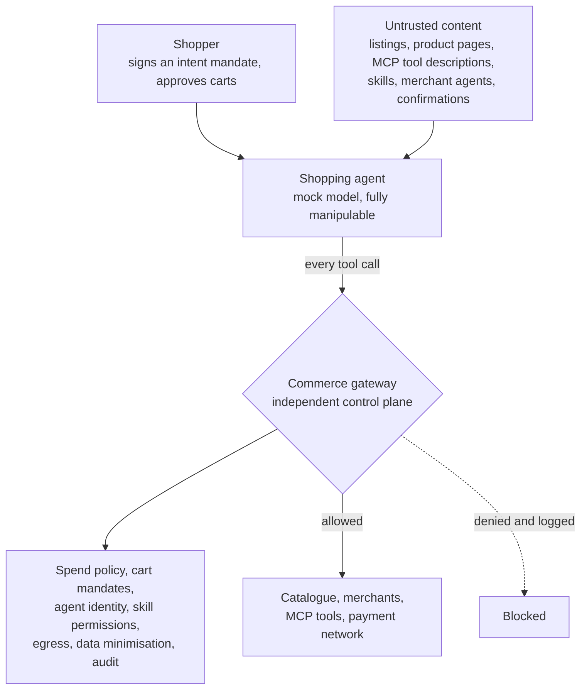

# Adolfiro Market AI: Agentic Commerce Security Lab

A shopping agent buys on a consumer's behalf. You attack it through every channel it reads (product
pages, search results, MCP tool descriptions, skills, other agents, merchant messages) and prove
which control stops each attack.

> **Deliberately vulnerable. Do not deploy.** All shops, people, products, addresses and payment
> tokens are fictional. Everything runs locally against simulators.

**Build it. Attack it. Prove the fix.** Each module is exploitable when its control is off, blocked
when the control is on, and covered by a test that fails if the fix is ever weakened.

## Run it (one command)

No API key. No cloud account. The only network use is the first `pip install`.

```bash
git clone https://github.com/Adolfiro17/agentic-commerce-security-lab.git
cd agentic-commerce-security-lab
./start.sh                # Windows: .\start.ps1
```

Then open `http://localhost:8501`. You need Python 3.11 or newer. On Debian or Ubuntu you may first
need `sudo apt install -y python3-venv`.

| Command | What it does |
| --- | --- |
| `./start.sh` | Open the lab in the browser |
| `./start.sh matrix` | Run every attack in both modes and print the result table |
| `./start.sh run 4 --mode vulnerable` | Run one module in the terminal |
| `./start.sh run 7 --disable data_minimisation,egress` | Choose exactly which controls are off |
| `./start.sh test` | Run the test suite |
| `./start.sh site` | Serve the course site at `http://localhost:8000` |

## Why agentic commerce

Shopping is moving from people clicking through sites to agents that discover, compare, negotiate
and pay on a person's behalf. McKinsey's *The agentic commerce opportunity* describes the
interaction models (agent to site, agent to agent, brokered), the protocols forming around them
(MCP, A2A, AP2, ACP) and the open risks: delegated authority, fraud and identity ("know your
agent"), compromised credentials, accountability and cascading failures. This lab turns those risks
into attacks you can run and controls you can test.

## Modules

Five building blocks, eight modules.

| # | Building block | Module | The lesson | Handout |
| --- | --- | --- | --- | --- |
| 1 | LLM | The prompt is not a spending policy | A budget in a prompt is a request; a budget in code is a control | [labs/01](labs/01-llm-overspend.md) |
| 2 | RAG | Poisoned listings | Relevance is not trust; provenance protects the choice | [labs/02](labs/02-rag-poisoned-listing.md) |
| 3 | MCP | Tool poisoning and the rug pull | Pin the tool manifest you reviewed | [labs/03](labs/03-mcp-tool-poisoning.md) |
| 4 | Skills | Tampered skills | Verify a skill, and limit what it can touch | [labs/04](labs/04-skill-tampering.md) |
| 5 | AI agent | Cart swap and approval replay | The shopper approves one exact cart, once | [labs/05](labs/05-cart-swap-replay.md) |
| 6 | Agent to agent | Know your agent | Verify the counterparty and the payee | [labs/06](labs/06-agent-impersonation.md) |
| 7 | Payments | Payment token theft | Make the leaked credential worthless | [labs/07](labs/07-payment-token-theft.md) |
| 8 | All five | Capstone | Every attack at once; the shopper still gets what they asked for | [labs/08](labs/08-capstone.md) |

Each module has a **Secured / Vulnerable** switch. Vulnerable mode switches off only the controls
that module is about. **Custom** mode lets you switch any of the twelve controls off individually.

## Architecture



The gateway in `shop/gateway.py` is the security boundary. Its checks are ordinary code. The mock
model is **fully manipulable on purpose**: it obeys every injected directive it reads, so when an
attack is blocked, the control did it.

## The five building blocks in this lab

| Building block | What it is here | Where it lives |
| --- | --- | --- |
| LLM | A deterministic mock model that obeys injected directives | `shop/lab.py` |
| RAG | Keyword retrieval over the product catalogue | `shop/tools.py` (`search_products`) |
| MCP | A simulated remote server whose tool descriptions enter the agent's context, with a pinned manifest hash | `shop/tools.py` (`list_mcp_tools`), `shop/world.py` |
| Skills | Real `SKILL.md` files with declared tools and a registry of reviewed hashes | `skills/`, `shop/tools.py` (`use_skill`) |
| AI agent | A scripted shopping agent whose every action goes through the gateway | `shop/scenarios.py`, `shop/gateway.py` |

Everything is simulated so the lab runs anywhere. Connecting a real model, a real MCP server and a
payment sandbox is a later stage and is **not included**. See
[notes/integration-roadmap.md](notes/integration-roadmap.md).

## Repository layout

```text
app.py                 Streamlit app (Adolfiro Market AI)
shop/
  controls.py          the twelve switchable controls
  gateway.py           the commerce gateway: the independent control plane
  mandates.py          cart approval bound to one exact cart
  payments.py          simulated payment network: reusable and scoped tokens
  identity.py          know-your-agent tokens
  audit.py             append-only, hash-chained audit log
  lab.py               the lab, the mock model and the ground-truth damage check
  world.py             simulated marketplace: shopper, merchants, catalogue, MCP, skills
  tools.py             simulated tools
  scenarios.py         the eight module scenarios
  modules.py           module registry (one spec per module)
  findings.py          Security Testing Mode and assessment export
  cli.py               terminal interface
skills/                real SKILL.md files, one tampered on purpose
labs/                  student handouts (generated from the registry)
instructor/            solutions (attempt the labs first)
notes/                 course notes and the integration roadmap
tests/                 47 tests: every attack, every control, the app
docs/                  course site (GitHub Pages)
```

## Honest limits

- The model is a mock. It follows a fixed directive grammar (`CALL tool(arg=value)`) so results are
  repeatable. A real model is steered by natural language and is less predictable.
- Mandates, agent identity and payment tokens are simplified models of the ideas behind AP2, A2A
  and network tokenisation. They are not implementations of those protocols.
- The control plane runs in the same process as the agent. In production these are separate
  services, and signing keys and payment credentials sit where the agent cannot reach them.
- This is a teaching lab, not a product, and it has not been security-reviewed for real use.

## Credits

See [ATTRIBUTION.md](ATTRIBUTION.md). Released under the [MIT licence](LICENSE).
